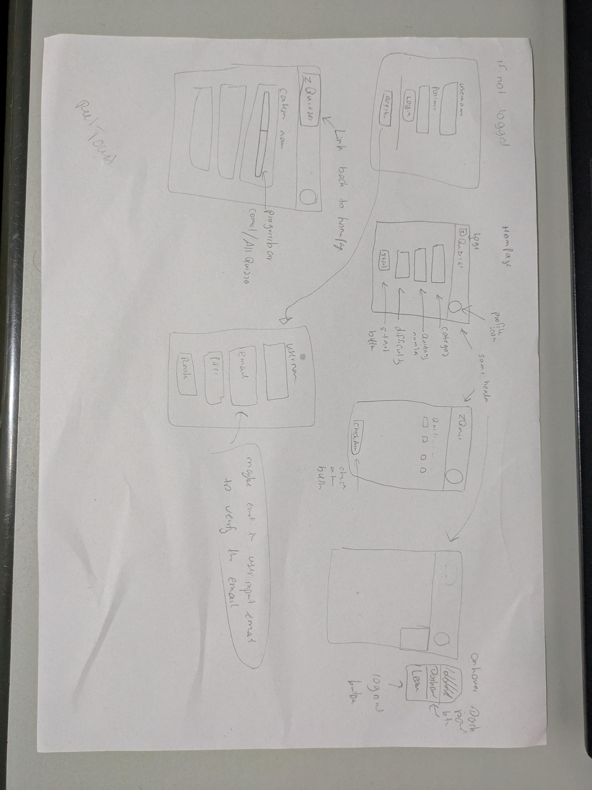

# Quizzical App — Project Plan

## 1. Base Requirements
- **Fetch Questions:** Pull questions from the Open Trivia Database (OTDB) API.
- **Display UI:** Render questions alongside interactive choice buttons.
- **Answer Evaluation:** Check and score user choices upon submission.
- **Tally Display:** Present the final score and round results once completed.

---

## 2. Additional Functionality (Full-Stack Features)
- **User Authentication:** 
  - User registration (sign up) and login/logout functionality.
  - Password hashing (via `bcrypt`) and session management (JWT or Express sessions).
- **Session Tracking:** 
  - Maintain session state to track player progress and ensure OpenTDB does not return duplicate questions.
- **Category-Based Score Analytics:** 
  - Track and store user performance breakdown across specific categories:
    - Science: Computers
    - Entertainment: Film
    - Entertainment: Music
    - Entertainment: Video Games
- **Express API Proxy:**
  - Secure score checking server-side (prevent exposing answers in client DevTools).
  - Decode HTML entities returned by OpenTDB before sending data to React.

---

## 3. Program Flow
